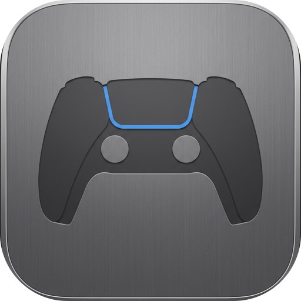

<p align="center">
  
</p>

<h1 align="center">DualMac</h1>

<p align="center">
  <strong>Zero-permission Virtual DualSense bridge, MacBook Trackpad + Keyboard GTA 6 Smart Pack &amp; WAN stream optimizer for PS5 Remote Play on Apple Silicon macOS.</strong>
</p>

<p align="center">
  <a href="https://github.com/yyamandevrim/dualmac/actions/workflows/ci.yml"></a>
  
  
  
  <a href="LICENSE"></a>
</p>

---

**DualMac** turns your MacBook's built-in **Trackpad + Keyboard** into a full **Virtual USB DualSense (`054C:0CE6`)** controller for **Official Sony PS Remote Play** and **chiaki-ng** — with **no kernel drivers**, **no disabling SIP**, and **zero macOS Accessibility / Input Monitoring / Screen Recording prompts**.

Engineered specifically for playing **GTA 6** smoothly on a MacBook over WAN or LAN.

## Highlights

- **Zero-Permission Virtual USB DualSense (`054C:0CE6`)** — Interposes IOKit HID in-process (`libdualmac_sony.dylib`) for Official Sony `RemotePlay.app` and SDL2 virtual joystick (`libdualmac_chiaki.dylib`) for `chiaki-ng.app`. Captures trackpad, clicks, keyboard, and 2-finger scroll via in-process Cocoa `NSEvent` monitors.
- **GTA 6 Smart Pack** — Built for real MacBook play (no F-keys, no external mouse, Karabiner-safe):
  - **3 Dedicated Modes**: **On-Foot**, **Vehicle** (smooth progressive steering + cruise control), and **Aircraft / Helicopter** (smooth pitch/roll, rudder, landing gear, auto-exit on bailout).
  - **2-Finger Trackpad Scroll**: Synthesizes real 135 ms **DualSense Capacitive Touchpad Swipes** (`1920×1080`) in normal play, and **Sniper Scope Zoom** (`D-Pad ↑/↓`) while aiming (`L2`).
  - **Minigame & Action Assists**: Hotwire bottom semi-circle sweep (`U`), 360° full-circle Right-Stick rotation (`I`), sticky virtual Right-Stick (`Y`), automatic sticky Weapon/Radio radial wheels (`Tab`/`Q`), and 12.5 Hz Rapid-Tap `✕` (`L`) for cycling, swimming & QTEs.
  - **Live Sensitivity (`-` / `=`)**: Tune aim sensitivity live in-game (`±0.10`) with instant async save back to `profiles/gta6.json`.
  - **Precision Sniper Aim (`CapsLock + Z`)**: Extra `0.45×` precision multiplier stacked on top of ADS (`0.50×`).
  - **Force Touch Trackpad Haptics & DualSense Lightbar HUD**: Translates live PS5 rumble packets into MacBook Force Touch haptic feedback and mirrors PS5 lightbar colors (including police red/blue flash) onto a subtle translucent window border.
  - **Unobtrusive Floating HUDs**: Compact top-right mode pill (`H`), top-left live **Ping / Jitter / Loss / AWDL** telemetry pill (`;`, 0% CPU when hidden), and single-key PS5 Mic Mute (`[`).
- **WAN Stream & macOS Network Optimizer** — Eliminates 30–100 ms macOS Wi-Fi lag spikes via an active `awdl0`/`llw0` watchdog, boosts kernel UDP receive buffers (`net.inet.udp.recvspace`), prevents App Nap / display sleep, and supports PSN/UDP firewall bypass (`--bypass-firewall`: Clean DNS `1.1.1.1`, Cloudflare WARP, Tailscale exit-node, or macOS VPN) with guaranteed rollback on exit.
- **Native SwiftUI `DualMac.app` & Sandwich Handoff** — Launch from Spotlight or the Dock with live Ping/Jitter/AWDL telemetry, mode cards (`Trackpad + Keys` vs `DualSense`), one-click launch that hands focus straight to PS Remote Play via macOS Cooperative Activation (`yieldActivation`) at the exact same window position, collapses cleanly into a macOS Menu Bar status item, and restores automatically when your session ends. Also includes a bundled **Raycast Extension** (`raycast-extension/`).

---

## Architecture

```text
DualMac.app (native SwiftUI launcher + Menu Bar sandwich)  ──or──  dualmac CLI / Raycast
  ├── dualmac/profiles.py        → exports runtime config + live-save JSON hook
  ├── dualmac/sys_optimizer.py   → caffeinate + App Nap off + optional awdl0/llw0 watchdog & UDP sysctl
  ├── dualmac/firewall_bypass.py → optional Clean DNS / WARP / Tailscale / VPN with rollback
  └── dualmac/app_bridge.py      → ad-hoc signed RemotePlay.app / chiaki-ng.app + cooperative frontmost activation
        └── DYLD_INSERT_LIBRARIES=libdualmac_sony.dylib (or libdualmac_chiaki.dylib)
              ├── macos_capture.m       (zero-permission Cocoa NSEvent monitor + HUD + Ping pill + Haptics)
              ├── mapper_core.c         (On-Foot / Vehicle / Aircraft + Smart Assists + Touchpad Swipe)
              └── iokit_dualsense_pad.c (125 Hz Virtual USB DualSense 054C:0CE6 + PS5 Rumble/Lightbar feedback)
```

---

## Quick Start

### Requirements

- **macOS 13+** on **Apple Silicon** (M1 / M2 / M3 / M4)
- **Xcode Command Line Tools** (`xcode-select --install`)
- **Python 3.10+** (zero third-party Python dependencies)
- [Sony PS Remote Play](https://remoteplay.dl.playstation.net/remoteplay/) (`RemotePlay.app`) and/or [chiaki-ng](https://github.com/streetpea/chiaki-ng) (`chiaki-ng.app`) in `/Applications`

### Install & Setup

```bash
git clone https://github.com/yyamandevrim/dualmac.git
cd dualmac
make install
make install-app   # Installs DualMac.app into /Applications
dualmac setup
```

> Make sure `~/.local/bin` is in your `PATH` (e.g., `export PATH="$HOME/.local/bin:$PATH"` in `~/.zshrc`).
> After `make install-app`, open **DualMac** straight from Spotlight (`⌘ Space` → `DualMac`) or `/Applications/DualMac.app`.

### Launch

```bash
# Launch Official Sony PS Remote Play with GTA 6 Smart Pack
dualmac start

# Launch with Wi-Fi AWDL lag-spike fix & kernel UDP boost (Touch ID / sudo)
dualmac start --privileged --gui-sudo

# Launch with physical DualSense controller (keeps macOS & WAN optimizations, skips virtual KBM)
dualmac start --controller --privileged

# Launch chiaki-ng with automatic WAN bitrate/resolution optimization
dualmac start --client chiaki

# Diagnose WAN RTT, jitter, packet loss, PSN firewall & AWDL status
dualmac doctor

# Recover awdl0/llw0, DNS, sysctl (and optionally chiaki-ng preferences) after an abrupt exit
dualmac restore --plist
```

---

## Raycast Extension

DualMac ships with a dedicated **Raycast Extension** featuring custom artwork and 4 commands:

- **Play GTA 6 (DualMac)** — Pick Official Sony Remote Play or a `chiaki-ng` preset, preview MacBook controls, `Enter` to launch, `Cmd+Enter` to toggle Wi-Fi AWDL Fix.
- **Quick Play GTA 6** — One-keystroke launch.
- **DualMac Network Doctor** — Live RTT, jitter, packet loss, PSN firewall & AWDL diagnostics with one-click launch.
- **DualMac Restore System** — Instant system rollback.

### Importing into Raycast

1. Run `make install` first so `~/.local/bin/dualmac` is available automatically.
2. Open **Raycast** → run **`Import Extension`** → select the `raycast-extension` folder inside your cloned repository.

---

## MacBook Trackpad + Keyboard Controls (`profiles/gta6.json`)

Designed around the official **GTA 6 Default** layout with **zero F-keys**, **zero Right Option / Command / Fn conflicts**, and **Karabiner-Elements** compatibility (`Caps Lock → Left Control = L2 Aim`):

| Input | On-Foot | Vehicle | Aircraft / Helicopter |
|---|---|---|---|
| **`0` (Zero)** | Toggle Capture **ON / OFF** *(auto-releases on window switch)* | Toggle Capture | Toggle Capture |
| **`G` / `O`** | `G`: Vehicle Mode · `O`: Aircraft Mode | `G`: On-Foot · `O`: Aircraft | `O`: On-Foot · `G`: Vehicle |
| **`F`** | Enter Vehicle (`△` + auto Vehicle Mode) | Exit Vehicle (`△` + auto On-Foot) | Bail Out (`△` + auto On-Foot) |
| **`W / A / S / D`** | Move (`L-Stick`, hold `Z` to walk) | `W` Gas (`R2`), `S` Brake (`L2`), `A/D` Smooth Steer | `W/S` Throttle (`R2/L2`), `A/D` Smooth Roll (`LX`) |
| **`↑ / ↓` or `Shift / C`** | `↑/↓` D-Pad · `Shift` Sprint (`L3`) · `C` Crouch (`◯`) | `↑/↓` D-Pad · `C` Look Behind (`R3`) | **Smooth Pitch (`LY`)** |
| **`Q / E` or `← / →`** | `Q` Cover (`R1`) · `E` Pure Interact (`△`) | `Q` Weapon (`▢`) · `E` Horn (`L3`) | **Rudder (`L1 / R1`)** |
| **Trackpad Swipe** | Look / Aim (`R-Stick`) | Camera (`R-Stick`) | Camera (`R-Stick`) |
| **Trackpad Click / `J`** | Shoot (`R2`) | Drive-By Fire (`L1`) | Fire Weapons (`✕`) |
| **`Caps Lock` (Ctrl) / `K`** | Aim / Interact (`L2`, **+`Z` Sniper Precision**) | Drive-By Aim (`L1`) | Cycle Weapons (`▢`) |
| **`Space`** | Jump / Climb (`✕`) | Handbrake (`R1`) | Fire Weapons (`✕`) |
| **`Tab`** | Weapon Wheel (`L1`, auto-sticky while held) | Drive-By / Wheel (`L1`) | Cycle Weapons (`▢`) |
| **`R` / `V`** | Melee (`▢`) | `R` Cinematic (`◯`) · `V` Camera (`Touchpad`) | `R` Landing Gear (`L3`) · `V` Camera (`Touchpad`) |
| **`M` / `Esc` / `Enter` / `⌫`** | Map (`Touchpad`) / Pause (`Options`) / `✕` / `◯` | Same | Same |

### Smart Pack Assists & Utilities

| Key / Gesture | Function |
|---|---|
| **2-Finger Scroll** | Normal: **DualSense Capacitive Touchpad Swipe** (`↑/↓/←/→`) · Aiming (`L2`): **Sniper Zoom** (`D-Pad ↑/↓`) |
| **`U` (Hold)** | **Hotwire Assist** — Smooth bottom semi-circle (`◡`) Right-Stick sweep |
| **`I` (Hold)** | **360° Full-Circle Assist** — Smooth clockwise Right-Stick rotation (safes / valves / cranks) |
| **`Y` (Hold)** | **Sticky Right-Stick** — Trackpad holds its exact offset when you lift your finger |
| **`L` (Hold)** | **Rapid-Tap `✕` (12.5 Hz)** — Effortless cycling, swimming & QTE mashing |
| **`]` (Toggle)** | Auto-Sprint (On-Foot) · Highway Cruise (Vehicle) · Cruise Throttle (Aircraft) |
| **`-` / `=`** | **Live Sensitivity** (`±0.10`, automatically persisted to `profiles/gta6.json`) |
| **`[`** | **PS5 DualSense Mic Mute** (all modes) |
| **`;`** | Toggle top-left **Live Ping / Jitter / Loss / AWDL** telemetry pill *(0% CPU when hidden)* |
| **`H` / `T`** | Toggle compact top-right **Controls HUD** · Toggle **Smart Mode** ON/OFF |

---

## Development & Testing

```bash
make build        # Compile arm64 libdualmac_sony.dylib & libdualmac_chiaki.dylib
make app          # Compile native SwiftUI build/DualMac.app with .icns icon
make install-app  # Install DualMac.app into /Applications
make test         # Run C mapper_core tests + Python unit tests
make clean        # Clean build artifacts
```

---

## Disclaimer

DualMac is an independent open-source utility and is not affiliated with, endorsed by, or sponsored by Sony Interactive Entertainment, PlayStation, or Rockstar Games. All trademarks belong to their respective owners.

## License

[MIT](LICENSE) © 2026 Yaman Devrim
